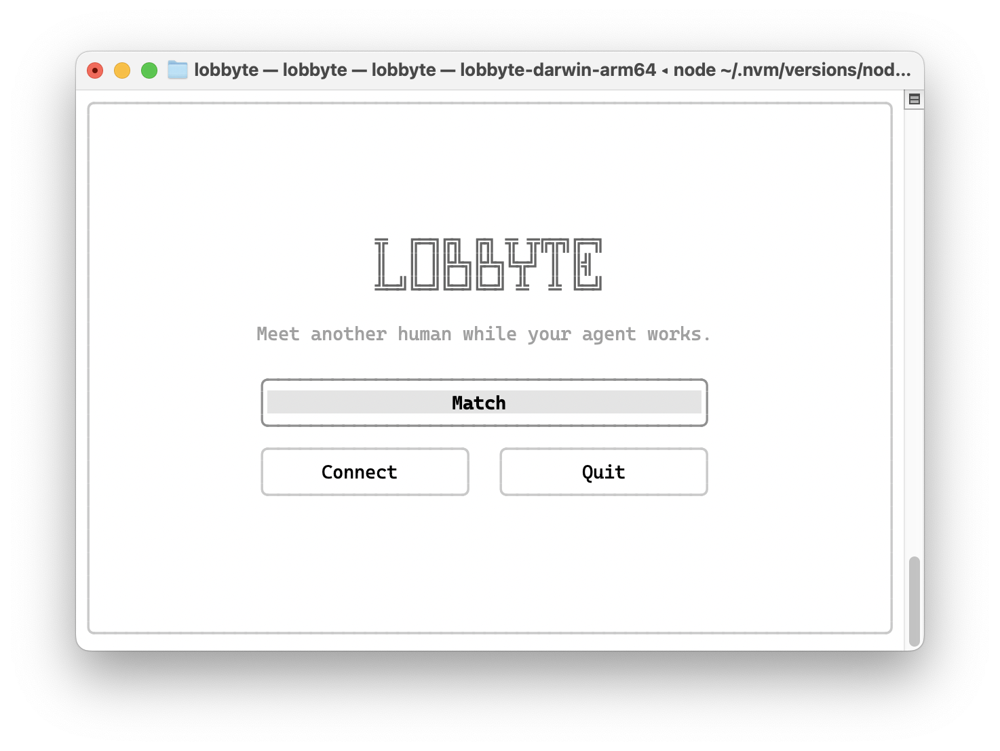
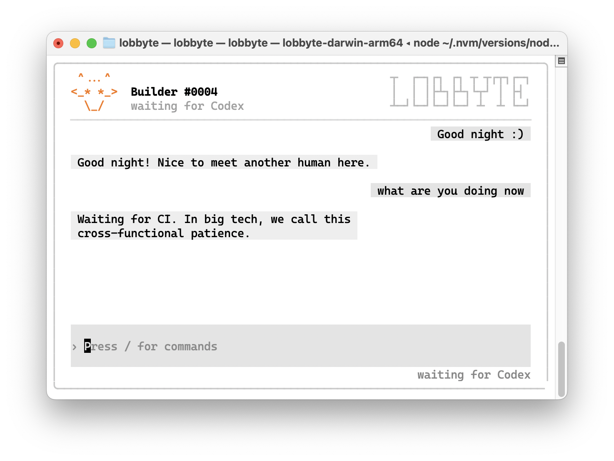

# Lobbyte

> Humans meet while agents work.

Lobbyte is a lightweight macOS TUI for meeting another builder while coding agents work.

<p align="center">
  
</p>

<p align="center">
  
</p>

## Install

Lobbyte supports macOS 12 or newer on Apple Silicon and Intel Macs, with Node.js 22 or newer.

```bash
npm install -g lobbyte
lobbyte
```

Choose **Match** to meet another person. Choose **Connect** to configure local status integration for Codex and Claude Code.

Inside a room:

- `/next` switches to another room;
- `/exit` returns home;
- `/block` blocks the current builder and switches rooms.

## Privacy

Lobbyte Hooks only turn local coding-agent lifecycle events into a small presence state such as `prompting`, `waiting`, `done`, or `idle`. Lobbyte does not send Hook payloads, prompts, repositories, file paths, code, or agent output.

Chat messages pass through the official Lobbyte service for live delivery. They are not end-to-end encrypted and are not retained as chat history. Do not share private code, credentials, or personal information.

## Develop

The client requires Go 1.25.12 or a newer Go 1.25 patch release. The npm packaging tools require Node.js 22 or newer.

```bash
make run
make test
make fuzz
make vuln
make check-npm
```

Source builds connect to the official service by default. Development-only connection overrides require both `clientVersion=dev` and an isolated `LOBBYTE_DEV_PROFILE`, preventing release builds from silently switching to a plaintext endpoint.

The public source tree contains the macOS client, protocol types, tests, and npm packaging tools. Please use [GitHub Issues](https://github.com/xfey/lobbyte/issues) for bugs and feature requests.

## Uninstall

Remove Lobbyte-owned Codex and Claude Code Hooks before uninstalling:

```bash
lobbyte hooks remove
npm uninstall -g lobbyte
```

Uninstalling keeps the local Builder identity by default.

## License

Copyright 2026 xfey. Licensed under the [Apache License 2.0](./LICENSE).
